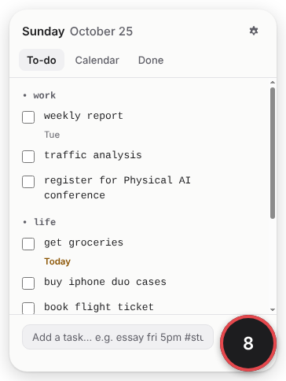
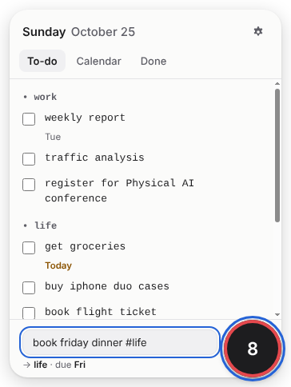

# Orb: the to-do ball

<p>
  
  
  
</p>

A tiny to-do list that floats above whatever you're doing, with a calendar, and that
Claude can add to from a chat. Modelled on [lilian.world's "to-do ball"](https://lilian.world):

1. **Always there.** A ball floats over every app, every desktop and full-screen windows.
2. **One-glance check.** The number is what's left. The ring turns **red** if something is overdue, **amber** if something is due today. Hover for the full list.
3. **Stays out of the way.** Click the ball to pin the panel open. While pinned it fades when your mouse leaves, and clicks pass through to the app underneath. <kbd>Esc</kbd> closes it.
4. **AI can reach it too.** Say "add that to my to-do" in Claude and it shows up here.

And the part the original doesn't have: **a calendar.** Your real calendars (Google,
iCloud, Canvas, Schoology) appear next to your tasks. You or Claude can block time for a
task, Orb reminds you when that time starts, and your due dates show up in your calendar app.

Your list is one plain Markdown file, `~/Documents/Orb/todo.md`, and nothing leaves your
computer. The format is in [docs/FORMAT.md](docs/FORMAT.md). Why it's built this way is in
[docs/BRIEF.md](docs/BRIEF.md).

## Install

**Option A: download (no coding).** On GitHub, open this repository → **Actions** →
the latest green **CI** run → **Artifacts** → `Orb-mac` (or `Orb-windows`). Unzip it
and open the `.dmg` that matches your Mac (`arm64` = Apple chip, M1 or later; `x64` = Intel).
Drag Orb to Applications.

The app isn't signed with a paid Apple certificate, so the first time:
right-click Orb → **Open** → **Open**. If macOS says it's "damaged", run this once in
Terminal: `xattr -cr /Applications/Orb.app`

**Option B: run from source.** Needs [Node.js](https://nodejs.org) 22 or newer:

```bash
npm install
npm start
```

## Use it

**Desktop widget (default).** Orb sits on your desktop like a Mac widget: behind your
app windows, in the same place on every desktop/Space. Drag it by the date at the top
to move it, and it remembers the spot. Drag any edge or corner to resize it, like a window, or
right-click → **Widget size** → *Same as a large Mac widget* to line it up with your other widgets. Press <kbd>⌘ Shift Space</kbd> to bring it
in front for a moment to type a task; it goes back behind when you click away.

Prefer the original floating ball that stays on top of everything? Right-click Orb →
**Switch to floating ball** (and back the same way).


| Do this | How |
|---|---|
| Add a task | Type in the box at the bottom: `essay fri 5pm #study`. The line underneath shows what Orb understood before you press Enter. |
| Open from the keyboard | <kbd>⌘ Shift Space</kbd> (Windows: <kbd>Ctrl Shift Space</kbd>) |
| Edit | Double-click a task (or focus it and press Enter) |
| Block time for it | Hover a task → ◷. Orb suggests your next free half hour. |
| Move it | Widget: drag the date header. Ball: drag the ball; drop it on a screen edge to tuck it away as a thin tab. |
| Pin / unpin (ball mode) | Click the ball |
| Everything else | Right-click the ball (open the file, start at login, quit) |

Quick-add tips: `#section` picks the section (a new name creates one), dates like
`tomorrow at 3`, `next tue 4:30pm`, `10/21` or `in 3 days` work, and `"quoted text"` is
never read as a date.

## Connect Claude

Orb → ⚙ Settings → **Connect to Claude Desktop**, then quit and reopen Claude Desktop.
For Claude Code, copy the command shown under it into a terminal.

Then, in a chat:

- "add book friday dinner to my to-do"
- "what's overdue?"
- "I finished the chem lab"
- "find me an hour tomorrow for the essay and block it"

Claude uses Orb's tools (`add_task`, `list_tasks`, `complete_task`, `update_task`,
`delete_task`, `list_calendar`, `find_free_time`, `plan_task`, `refresh_calendars`).
Every change it makes is logged in `~/Documents/Orb/activity.log`, and the previous file
is backed up first.

## Add your calendars

Settings → **Your calendars** → paste the calendar's private `.ics` link (the panel
explains where Google, iCloud, Canvas and Schoology keep it). Orb refreshes every
15 minutes and keeps a copy for offline use.

To see Orb's due dates and planned blocks *in* Apple Calendar: File → New Calendar
Subscription → `http://127.0.0.1:47110/orb.ics`. The same feed is also saved as
`~/Documents/Orb/orb.ics`.

## Develop

```bash
npm test                 # 80 unit + integration tests, including the real MCP server over stdio
xvfb-run npm run e2e     # optional: drives the real app (Linux; plain `npm run e2e` elsewhere)
npm run dist             # build an installer for this OS into dist/
```

```
src/core/     file format, store (lock + atomic writes + backups + log), quick add,
              calendar (ical.js), feeds, the service both front ends share
src/main/     Electron main process, ball geometry, Claude setup
src/renderer/ the panel
src/mcp/      the MCP server Claude talks to
```

Credits for copied code are in [THIRD_PARTY_NOTICES.md](THIRD_PARTY_NOTICES.md).
